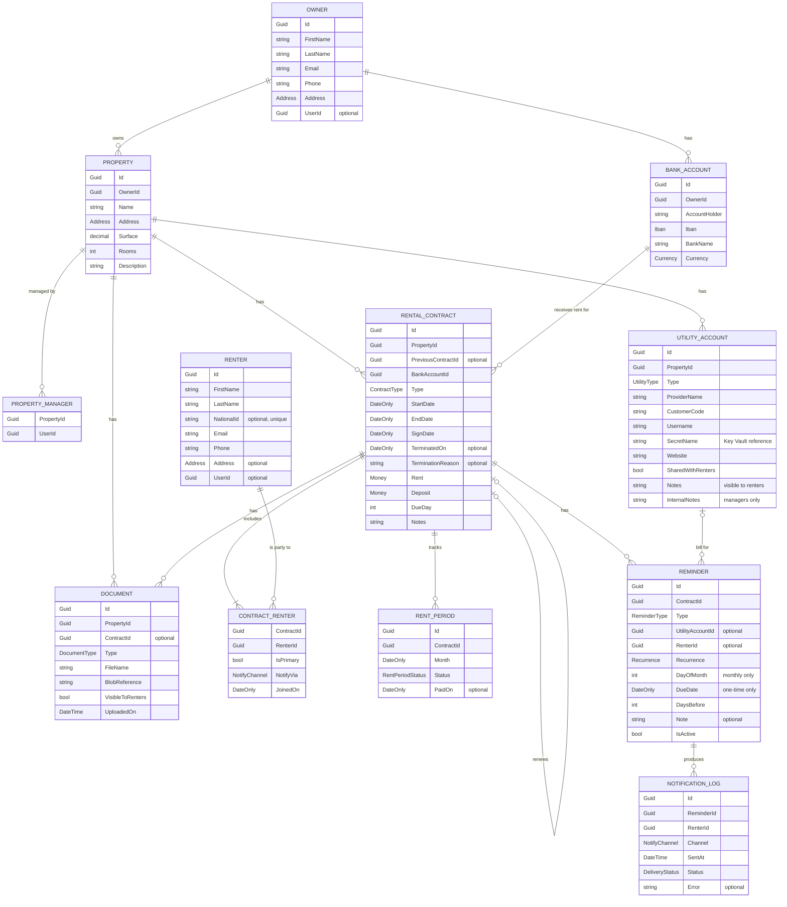

# Propissimo – Domain Model

This document describes the entities, value objects, relationships and business rules of Propissimo.

---

## Overview

All entities also carry audit fields (`CreatedOn`, `UpdatedOn`), populated automatically.

User accounts (login, password, roles) are managed by ASP.NET Core Identity and are not part of the domain model. Domain entities reference them through an optional `UserId`.

---

## Entities

### Owner
The legal owner of one or more properties. An owner may optionally have a user account to view their properties in read-only mode.

### BankAccount
A bank account belonging to an owner, into which rent is paid. An owner can have several accounts (for example one in RON and one in EUR).

### Property
A rental property (apartment, house). Belongs to exactly one owner.

### PropertyManager
Links a property to the users who manage it. A property can have several managers, and a manager can manage several properties. Access to a property's data is granted through this relationship.

### RentalContract
A rental agreement for a whole property, with a fixed rent for its whole duration. A property has at most one contract at any point in time; the contract can include several renters. Past and future contracts are kept as the property's rental history.

A change in rent is handled by signing a **new contract**. The new contract references the one it replaces through `PreviousContractId`, which keeps the full history of a tenancy.

### ContractRenter
Links a contract to its renters and holds the data that belongs to that relationship: whether the renter is the primary contact, their preferred notification channel and the date they joined the contract.

### Renter
A person who rents. The same renter can be party to several contracts over time (for example successive renewals). A renter may be created before they have a user account; the account is linked once they accept an invitation.

### RentPeriod
One entry per contract per month, recording whether that month's rent has been received. Marked as paid manually by a manager.

### UtilityAccount
An account with a utility provider (electricity, gas, water, internet, building association fees) for a property. The password is stored in Azure Key Vault; the database holds only a reference to the secret. Accounts can be shared selectively with the renters of the property.

Each account has two kinds of notes: `Notes`, visible to renters when the account is shared (for example, what the account covers), and `InternalNotes`, visible only to managers and the owner.

### Document
A file stored in Azure Blob Storage. Every document belongs to a property; documents related to a specific contract also reference that contract.

### Reminder
A notification to be sent to the renters of a contract. Reminders are either:
- **Monthly** (recurring on a day of the month), used for rent. Created automatically from the contract's due day.
- **One-time** (on a specific date), used for utility bills, whose due dates vary.

### NotificationLog
A record of every notification sent: recipient, channel, time and delivery result.

---

## Value objects

Value objects have no identity of their own, are compared by value and are immutable.

| Value object | Contents | Rules |
|---|---|---|
| **Address** | Country, City, Street, Number, Building, Floor, Apartment, PostalCode | Country, city and street are required |
| **Money** | Amount (`decimal`), Currency | Amount is not negative; amounts in different currencies cannot be combined |
| **Iban** | IBAN string | Valid format and check digits (ISO 13616, mod 97) |

---

## Enumerations

| Enum | Values |
|---|---|
| **Currency** | RON, EUR |
| **ContractType** | LongTerm, ShortStay |
| **NotifyChannel** | Email, WhatsApp, WhatsAppGroup, None |
| **RentPeriodStatus** | Pending, Paid |
| **UtilityType** | Electricity, Gas, Water, Heating, Internet, Tv, Waste, AssociationFees, Other |
| **DocumentType** | PowerOfAttorney, SaleDeed, EnergyCertificate, SignedContract, TerminationAgreement, HandoverProtocol, TaxRegistration, UtilityBill, Other |
| **ReminderType** | Rent, UtilityBill, Other |
| **Recurrence** | Monthly, OneTime |
| **DeliveryStatus** | Sent, Failed |

### Contract status
The status of a contract is derived, not stored:

| Status | Condition |
|---|---|
| **Upcoming** | Today is before `StartDate` |
| **Active** | Today is between `StartDate` and `EndDate`, and the contract is not terminated |
| **Expired** | Today is after `EndDate` |
| **Terminated** | `TerminatedOn` is set |

---

## Roles and access

| Role | Access |
|---|---|
| **Manager** | Full access to the properties they manage (through `PropertyManager`), and to everything related to them |
| **Renter** | Read-only access to the contracts they are party to, the bank account for paying rent, their rent periods, documents marked as visible to renters, and utility accounts marked as shared |
| **Owner** *(planned)* | Read-only access to the properties they own, including income overview |

Roles define what kind of operations a user can perform. Every request is additionally checked against the specific resource: a user can only access data linked to them.

A user can have more than one role.

---

## Business rules

### Contracts
1. `EndDate` must be after `StartDate`.
2. The contracts of a property must not overlap in time. A contract's effective end is `TerminatedOn` when set, otherwise `EndDate`. A future contract can be added while the current one is still active, as long as the periods do not overlap.
3. A contract has at least one renter.
4. A contract has **at most one** primary renter. Renters can also be equal, with no primary contact. Setting a new primary renter removes the flag from the previous one.
5. The currency of the bank account must match the currency of the rent.
6. A contract can be terminated early with a date and a reason. The termination date must fall within the contract period, and a contract cannot be terminated twice.
7. Renewing a contract creates a new contract that references the previous one. Property, renters, primary contact, notification preferences, bank account and deposit are carried over and can be adjusted.

### Rent periods
8. A rent period exists for each month of the contract.
9. Only a manager can mark a rent period as paid.
10. When a contract is terminated, rent periods after the termination date are removed.

### Reminders
11. A monthly rent reminder is created automatically for each contract, based on its due day.
12. Reminders are not sent for months already marked as paid.
13. Reminders are not sent after a contract has ended or been terminated.
14. Each renter receives reminders through their own notification channel. A reminder can target all renters of the contract or a single renter.
15. The same reminder is never sent twice to the same renter for the same occurrence (checked against the notification log).

### Documents
16. A document linked to a contract must belong to the same property as that contract.
17. Property documents (for example power of attorney, sale deed) are never visible to renters.

### Utility accounts
18. Utility account passwords are stored only in Azure Key Vault.
19. Renters see a utility account only when it is shared with them, and then only its public `Notes`, never `InternalNotes`.

### Bank accounts
20. Every change to a bank account is recorded in the audit log.
21. When the bank account for a contract changes, the renters of that contract are notified.

### Renters
22. The national identification number (CNP) is optional and unique across renters.

---

## Planned

- **Payment amounts and arrears:** recording amounts received, partial payments and overdue balances
- **Expenses:** costs per property (repairs, taxes, fees), enabling profit reporting
- **Owner portal:** read-only access for owners, with income overview
- **Bank statement import:** matching bank transactions to rent periods automatically
- **ANAF registration reminder:** a reminder when a new contract has no tax registration document attached after a set number of days
